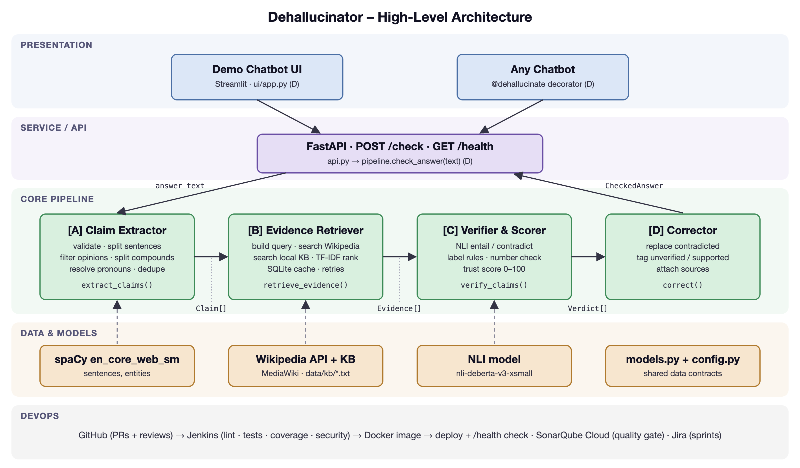

# Architecture Document

**Project 39: Dehallucination Add-On Module ("Dehallucinator")**

Sections:
1. High-Level Architecture Overview (Role A) – this file
2. Evidence Retriever component (Role B) – `architecture_evidence_retriever.md`
3. Verifier component (Role C) – [Architecture — Verifier & Scorer](architecture_verifier.md)
4. API, UI and deployment (Role D) – [`architecture_api_ui_deployment.md`](architecture_api_ui_deployment.md)

---

## 1. High-Level Architecture Overview (Owner: Sai Nikitha Perumalla, Role A)

### 1.1 Architectural Style

Dehallucinator uses a **layered architecture** with a **pipe-and-filter** core. A request passes through four independent stages in a fixed order, and each stage takes the previous stage's output and adds to it.

- **Presentation:** the Streamlit demo chatbot and the `@dehallucinate` decorator for plugging into any chatbot.
- **Service:** a FastAPI REST API (`POST /check`, `GET /health`).
- **Core pipeline:** Claim Extractor → Evidence Retriever → Verifier & Scorer → Corrector.
- **Data and models:** spaCy language model, Wikipedia API, local knowledge base, NLI model, shared data models.

*Figure 1: High-level architecture of Dehallucinator*

### 1.2 Components

- **Claim Extractor (Role A):** splits the AI answer into standalone factual claims.  
  Interface: `extract_claims(text) -> list[Claim]`.
- **Evidence Retriever (Role B):** finds supporting or contradicting text for each claim in Wikipedia and the local knowledge base.  
  Interface: `retrieve_evidence(claims) -> list[Evidence]`.
- **Verifier & Scorer (Role C):** uses an NLI model to label each claim SUPPORTED, CONTRADICTED or NOT_ENOUGH_INFO, and computes a trust score.  
  Interface: `verify_claims(claims, evidence) -> list[Verdict]`.  
  See [Architecture — Verifier & Scorer](architecture_verifier.md) for the UML class and sequence diagrams.
- **Corrector & Integrator (Role D):** rewrites the answer using the verdicts and exposes the whole pipeline through the API, UI and decorator.  
  Interface: `check_answer(text) -> CheckedAnswer`.

### 1.3 Data Flow

1. A user or chatbot sends an AI-generated answer to `POST /check`.
2. The API validates the input and calls