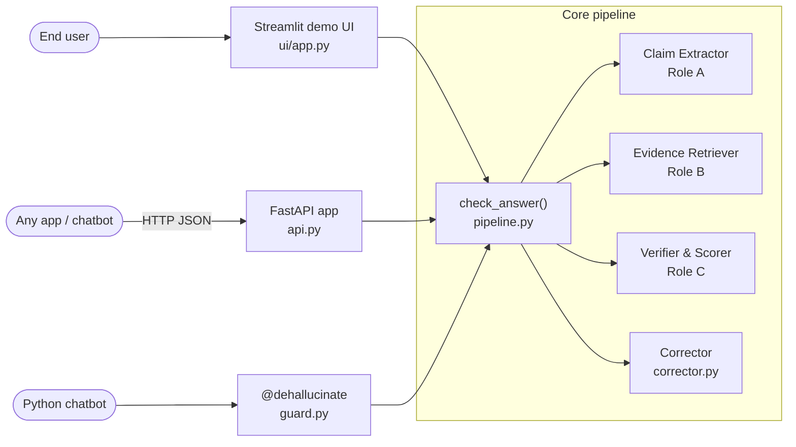
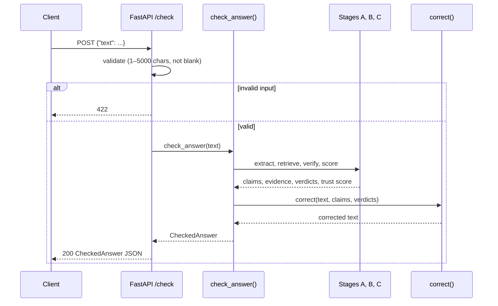
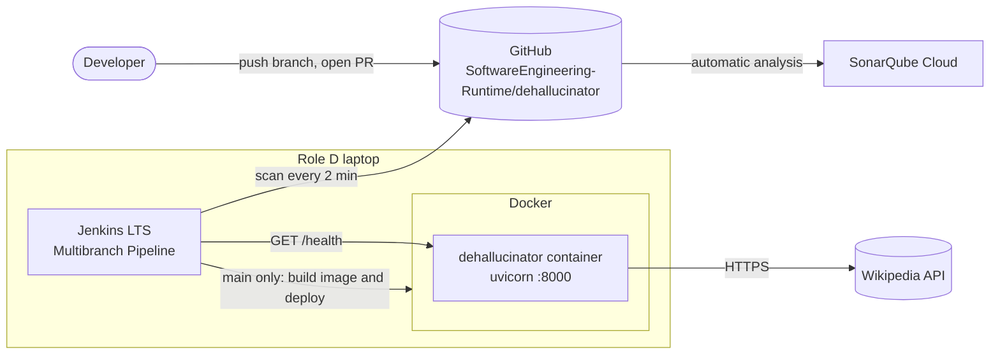

# Architecture: API, UI and Deployment (Role D)

Owner: Satwik (Role D). Section 4 of the Architecture Document.

## 1. Purpose
Connects the four pipeline stages into one call and makes it usable from outside: a REST API
for any application, a decorator for Python chatbots, and a demo UI for end users. Also covers
how the system is built, tested and deployed. Requirements: FR-4.1 to FR-4.6, NFR-3, NFR-5.

## 2. Components

*Figure 4.1: Entry points (UI, API, decorator) and how they reach the core pipeline.*

| Component | Module | Responsibility | Requirement | Status |
|---|---|---|---|---|
| Corrector | `correct/corrector.py` `correct` | Rewrites the answer from the verdicts: CONTRADICTED claims replaced by the evidence and its source, NOT_ENOUGH_INFO tagged `[unverified]`, SUPPORTED tagged with the source | FR-4.1 | Sprint 1 |
| Pipeline | `pipeline.py` `check_answer` | Runs extract → retrieve → verify → score → correct, logs each stage's time, returns a `CheckedAnswer` | FR-4.2 | Sprint 1 |
| REST API | `api.py` `app` | `POST /check` and `GET /health`; validates input; maps errors to HTTP status codes | FR-4.4, NFR-3 | Sprint 1 |
| Decorator | `guard.py` `dehallucinate` | Wraps any function that returns a `str` so it returns a `CheckedAnswer` | FR-4.3 | Sprint 2 (DH-178) |
| Demo UI | `ui/app.py` | Sample drop-down and paste box; colour-coded claims, sources, trust score and corrected answer | FR-4.5, FR-4.6 | Sprint 2 (DH-179) |

The API, the UI and the decorator all call the same `check_answer()`, so every entry point
gives the same result and the pipeline is tested once.

## 3. Interfaces

**Pipeline:** `check_answer(text: str) -> CheckedAnswer`, where
`CheckedAnswer = {original, corrected, claims, verdicts, trust_score}` (defined in `models.py`).
Raises `ValueError` for empty input or input over `MAX_INPUT_CHARS` (5000).

**Corrector:** `correct(text: str, claims: list[Claim], verdicts: list[Verdict]) -> str`.
It splits sentences with the Claim Extractor's own spaCy model and skips whitespace-only
sentences in the same way, so a claim's `sentence_index` points at the same sentence in both modules.

**REST API** (served with `uvicorn dehallucinator.api:app`):

| Endpoint | Request | Responses |
|---|---|---|
| `POST /check` | `{"text": "<AI answer>"}`; 1 to 5000 characters, not blank | 200: `CheckedAnswer` JSON. 422: invalid or malformed input. 500: `{"detail": "Internal server error"}` |
| `GET /health` | none | 200: `{"status": "ok"}` |

Request flow for `POST /check`:

*Figure 4.2: Request flow for `POST /check`.*

## 4. Dependencies

| Dependency | Used for |
|---|---|
| FastAPI + pydantic | REST API, request validation, JSON responses from the shared models |
| uvicorn | ASGI server that runs the API |
| Streamlit | Demo UI |
| spaCy `en_core_web_sm` | Sentence spans in the Corrector (shared with the Claim Extractor) |
| Modules A, B, C | `extract_claims`, `retrieve_evidence`, `verify_claims`, `trust_score` |
| `dehallucinator.config` | `MAX_INPUT_CHARS` |

## 5. Error handling

| Situation | Behaviour |
|---|---|
| Missing, empty, blank, wrong-type or over-long `text`, or malformed JSON | 422; the pipeline is not called |
| `ValueError` from the pipeline | 422 with the error message |
| Any other exception | Logged with its stack trace on the server; the client gets 500 with a generic message and no stack trace (NFR-3) |
| No factual claims | Retriever and Verifier are skipped; the corrected answer equals the original and the trust score is 100 |
| No evidence for a claim | The Verifier returns NOT_ENOUGH_INFO (FR-3.4) and the Corrector tags the claim `[unverified]` |

The `/check` endpoint is a plain `def`, so FastAPI runs the CPU-heavy pipeline in a worker
thread and `/health` stays responsive while a check is running.

## 6. Deployment view

*Figure 4.3: Deployment view. Jenkins and the container run on Role D's laptop.*

- **Source control:** GitHub. `main` is protected; every change is a pull request with one
  approval. Commits start with the Jira key so they appear on the ticket.
- **CI (Jenkins):** a Multibranch Pipeline job scans the repository every 2 minutes and builds
  every branch that has a `Jenkinsfile`. The 8 stages (DH-153, DH-180, DH-182, manual 11.4):
  Checkout, Setup, Lint (ruff), Security scan (bandit High issues, pip-audit), Unit tests
  (JUnit report, HTML coverage report, build fails below 80% coverage), Integration tests,
  and on `main` only Build image and Deploy (replace the container, then wait for
  `/health` with `ci/wait_for_health.py`). If Docker is missing on the agent, the two image
  stages mark the build UNSTABLE instead of failing it.
- **Container (DH-181):** a `python:3.11-slim` image with the dependencies (CPU-only
  PyTorch), the spaCy and NLI models and the API, running as a non-root user and started with
  one command, `docker run -p 8000:8000 dehallucinator` (NFR-5). Docker's `HEALTHCHECK` calls
  `GET /health`. The same image can start the Streamlit UI on port 8501.
- **Code quality:** SonarQube Cloud analyses every push (DH-154, DH-183).
- **External service:** the running container needs HTTPS access to Wikipedia; without it the
  Retriever falls back to the local KB baked into the image (FR-2.7).

## 7. Testing

| Level | Tests | Notes |
|---|---|---|
| Unit | `tests/unit/test_corrector.py` (TC-4-01 to TC-4-05), `test_pipeline.py`, `test_api.py` (TC-4-06 to TC-4-09), `test_guard.py` (TC-4-10), `test_ui.py` | Stages and `check_answer` are faked, so no network or model is used |
| Integration | `tests/integration/test_pipeline.py` (Role C, DH-197) | Full `check_answer` with mocks |
| System | `tests/system/test_end_to_end.py` (DH-198) | API with the 10 sample answers |
| Security | `tests/security/test_security.py` (DH-199) | Input limits, malformed JSON, script input |
