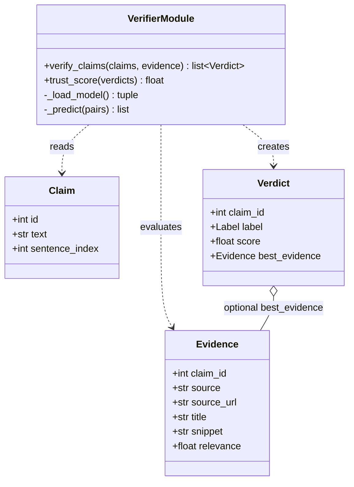

# Architecture — Verifier & Scorer (Role C)

## Purpose

The Verifier & Scorer evaluates each claim against its retrieved evidence using a Natural Language Inference (NLI) model. It assigns a verdict (`SUPPORTED`, `CONTRADICTED`, or `NOT_ENOUGH_INFO`) and a confidence score. The `trust_score()` function calculates an overall trust score from the verdicts.

## UML Class Diagram



*Note: `VerifierModule` represents the module-level functions in `verifier.py`, not a Python class.*

## UML Sequence Diagram — `verify_claims()`

```mermaid
sequenceDiagram
    participant Pipeline
    participant Verifier as Verifier Module
    participant Model as NLI Model

    Pipeline->>Verifier: verify_claim