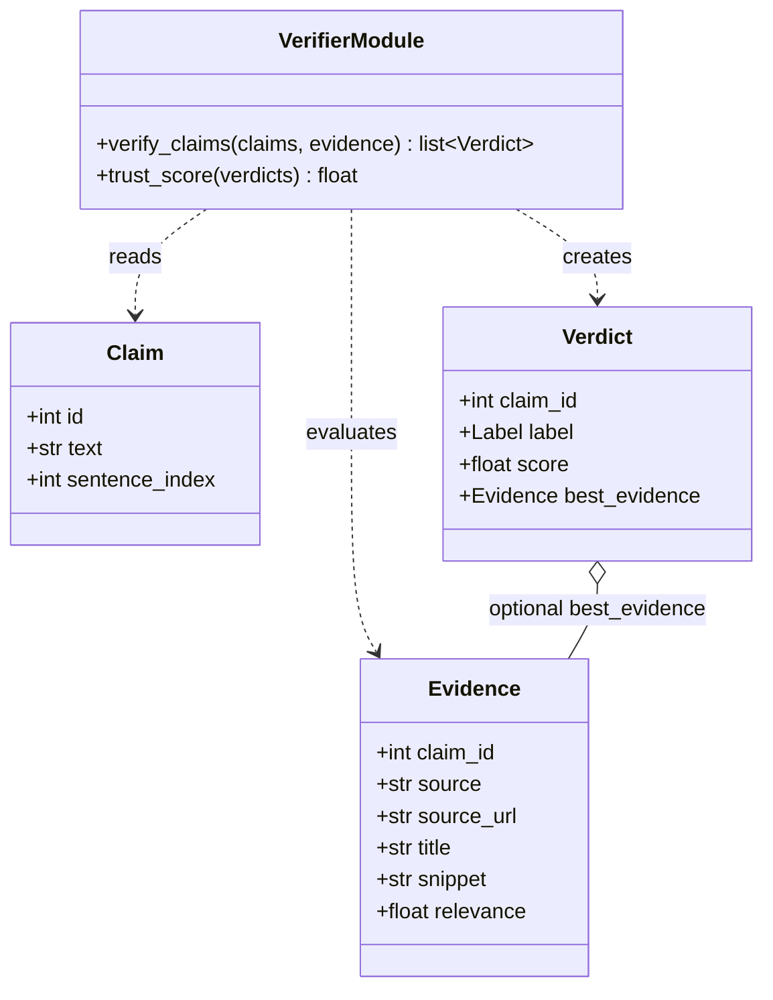

# Verifier & Scorer Architecture

**Project 39: Dehallucination Add-On Module ("Dehallucinator")**

**Component owner:** Role C — Verifier & Scorer

## 1. Purpose

The Verifier & Scorer evaluates each extracted factual claim against the evidence returned by the Evidence Retriever. It assigns a verdict to each claim, selects evidence for that verdict, and calculates an overall trust score for the answer.

## 2. Position in the Pipeline

The Verifier & Scorer is the third stage of the core pipeline:

Claim Extractor → Evidence Retriever → Verifier & Scorer → Corrector

It receives `Claim` objects and `Evidence` objects, returns a list of `Verdict` objects, and provides the trust score used by the pipeline.

## 3. Interfaces

- `verify_claims(claims, evidence) -> list[Verdict]`: evaluates each claim against its available evidence.
- `trust_score(verdicts) -> float`: calculates an overall trust score between 0 and 100.

Implementation: `src/dehallucinator/verify/verifier.py`. The model name and thresholds are configured in `src/dehallucinator/config.py`.

## 4. Models and Data Contracts

The component uses the shared Pydantic models in `src/dehallucinator/models.py`.

- **Claim:** `id`, `text`, and `sentence_index`.
- **Evidence:** `claim_id`, `source`, `source_url`, `title`, `snippet`, and `relevance`.
- **Verdict:** `claim_id`, `label`, `score`, and `best_evidence`.

The verdict label is `SUPPORTED`, `CONTRADICTED`, or `NOT_ENOUGH_INFO`. The score is between 0 and 1. `best_evidence` may be `None` when no evidence is available.

## 5. Verification Process

### 5.1 Evidence Matching

For each claim, the verifier selects evidence items whose `claim_id` matches the claim ID. If no matching evidence exists, it returns `NOT_ENOUGH_INFO`, with a score of `0.0` and no best evidence.

### 5.2 Natural Language Inference

The verifier uses the `cross-encoder/nli-deberta-v3-xsmall` Natural Language Inference (NLI) model. It evaluates each evidence snippet against the corresponding claim text.

The tokenizer and model are loaded lazily on first use and cached in module-level variables. Predictions run with PyTorch gradient calculation disabled, and model logits are converted to probabilities using softmax.

### 5.3 Verdict Assignment

The configurable thresholds are:

- `SUPPORT_THRESHOLD = 0.70`
- `CONTRADICT_THRESHOLD = 0.70`

The decision rules are:

1. **SUPPORTED:** the highest entailment probability meets the support threshold and is at least as high as the highest contradiction probability.
2. **CONTRADICTED:** the highest contradiction probability meets the contradiction threshold, and the support rule has not been met.
3. **NOT_ENOUGH_INFO:** neither rule applies.

For `SUPPORTED` and `CONTRADICTED`, the score is the corresponding maximum probability. For `NOT_ENOUGH_INFO` when evidence exists, the score is `1 - max(max_entailment, max_contradiction)`. The selected best evidence comes from the corresponding prediction.

## 6. Trust Scoring

The scorer maps verdicts to values:

| Verdict | Value |
|---|---:|
| `SUPPORTED` | 1.0 |
| `NOT_ENOUGH_INFO` | 0.5 |
| `CONTRADICTED` | 0.0 |

It averages these values, multiplies the result by 100, and rounds to one decimal place. If there are no verdicts, the trust score is `100.0`.

## 7. Runtime Considerations

- The model and tokenizer load only when verification first requires them.
- Once loaded, they are reused for subsequent calls in the same process.
- Inference runs without gradient calculation.
- Claims without matching evidence receive `NOT_ENOUGH_INFO` without an NLI prediction for that claim.

## 8. Dependencies and Configuration

- `transformers` provides the tokenizer and sequence-classification model.
- `torch` performs inference and probability calculation.
- `src/dehallucinator/models.py` defines the shared data contracts.
- `src/dehallucinator/config.py` defines the NLI model identifier and thresholds.

## 9. Output to the Next Stage

The verifier returns one `Verdict` per claim, including its ID, label, score, and best evidence where available. The Corrector uses these verdicts and their evidence to decide whether to preserve a sentence, attach a source, flag uncertainty, or replace contradicted content.

## 10. UML Class Diagram

The diagram shows the shared data models used by the verifier and the relationships between the module-level verification functions and those models.



*Note: `VerifierModule` represents the module-level functions in `verifier.py`, not a Python class.*

## 11. UML Sequence Diagram

The sequence diagram illustrates how `verify_claims()` matches evidence to each claim, handles claims with no matching evidence, obtains NLI predictions, assigns verdicts, and returns the results to the pipeline.

```mermaid
sequenceDiagram
    participant Pipeline
    participant Verifier as Verifier Module
    participant Model as NLI Model

    Pipeline->>Verifier: verify_claims(claims, evidence)
    loop For each claim
        Verifier->>Verifier: Match evidence by claim_id
        alt No matching evidence
            Verifier->>Verifier: Create NOT_ENOUGH_INFO verdict
            Note right of Verifier: Score = 0.0; best_evidence = None
        else Matching evidence found
            Verifier->>Model: Predict entailment and contradiction probabilities
            Model-->>Verifier: Return probabilities for evidence-claim pairs
            Verifier->>Verifier: Select best evidence and assign verdict
        end
    end
    Verifier-->>Pipeline: Return list of Verdict objects
    Pipeline->>Verifier: trust_score(verdicts)
    Verifier->>Verifier: Map verdicts to values and calculate mean
    Verifier-->>Pipeline: Return trust score (0–100)
```
