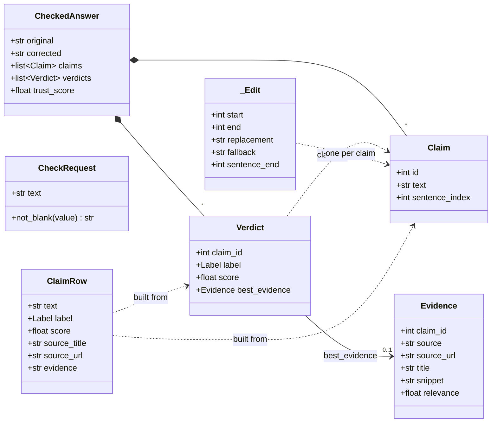
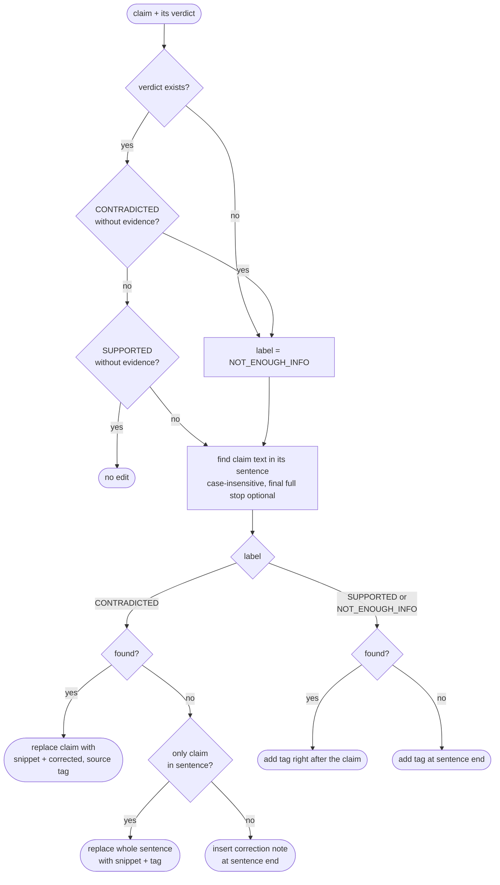
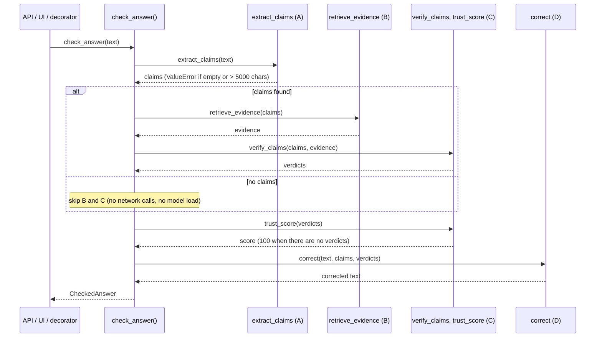
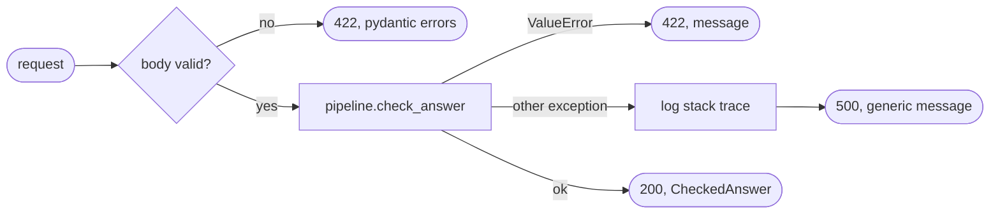

# Software Design: Corrector, Pipeline and API (Role D)

Owner: Satwik (Role D). Detailed design for the modules described at a high level in
[Architecture Section 4](../architecture/architecture_api_ui_deployment.md).
Requirements: FR-4.1 to FR-4.6.

## 1. Modules

| Module | Public interface | Requirement |
|---|---|---|
| `correct/corrector.py` | `correct(text, claims, verdicts) -> str` | FR-4.1 |
| `pipeline.py` | `check_answer(text) -> CheckedAnswer` | FR-4.2 |
| `guard.py` | `@dehallucinate` | FR-4.3 |
| `api.py` | FastAPI `app`: `POST /check`, `GET /health` | FR-4.4 |
| `ui_render.py`, `ui/app.py` | Streamlit page and its HTML helpers | FR-4.5, FR-4.6 |

## 2. Class diagram

The shared models come from `models.py` (frozen in manual Section 4.2). Role D adds the
private `_Edit` record in the Corrector, the `CheckRequest` body in the API and the
`ClaimRow` view model in the UI.

*Figure D.1: Data classes used by the Role D modules.*

## 3. Corrector design (FR-4.1)

`correct()` never edits the string in place. It first works out one `_Edit` per claim
(a character range to replace, or an insertion point), then applies all edits in one pass
from left to right. This keeps character positions valid however many claims there are.

**Steps**

1. If there are no claims, return the text unchanged.
2. Split the text into sentence spans with the Claim Extractor's own spaCy model
   (`get_nlp()`), skipping whitespace-only sentences and trimming surrounding whitespace,
   so `sentence_index` means the same sentence in both modules.
3. For each claim, in id order, decide its edit (Figure D.2).
4. Apply the edits: overlapping replacements become insertions at the end of their
   sentence (the `fallback` text), and no insertion may land inside replaced text.

*Figure D.2: How `_edit_for()` chooses the edit for one claim.*

| Label | Tag added | Example output |
|---|---|---|
| CONTRADICTED (with evidence) | `[corrected, source: <url>]` after the snippet | `The tower was built from 1887 to 1889. [corrected, source: https://en.wikipedia.org/wiki/Eiffel_Tower]` |
| NOT_ENOUGH_INFO | `[unverified]` | `The Eiffel Tower has 1,710 steps. [unverified]` |
| SUPPORTED | `[source: <url>]` | `The Eiffel Tower is located in Paris. [source: https://en.wikipedia.org/wiki/Eiffel_Tower]` |

Evidence snippets are collapsed to one line (`" ".join(snippet.split())`) so a snippet with
line breaks does not break the paragraph layout.

## 4. Pipeline design (FR-4.2)

`check_answer()` calls each stage through the `_timed()` helper, which records the
stage's duration in milliseconds. One INFO log line per answer lists the claim count,
trust score and all stage times. Exceptions are not caught here; the caller (API, UI or
decorator) decides how to report them.

*Figure D.3: `check_answer()` sequence.*

## 5. API specification (FR-4.4)

The machine-readable spec is [`openapi.json`](openapi.json) (OpenAPI 3.1), generated from
the FastAPI app. `tests/unit/test_api.py::test_committed_openapi_spec_matches_the_app`
fails if the file and the code ever differ. When the app is running, the same spec is
served at `/openapi.json` and as interactive docs at `/docs`.

### `GET /health`

| | |
|---|---|
| Purpose | Liveness check for Docker and the Jenkins Deploy stage |
| Request | No body |
| 200 | `{"status": "ok"}` |

### `POST /check`

| | |
|---|---|
| Purpose | Check and correct one AI answer |
| Request body | `CheckRequest`: `{"text": string}`, 1 to 5000 characters, not only whitespace |
| 200 | `CheckedAnswer` |
| 422 | Invalid body or malformed JSON: `{"detail": [ {loc, msg, type}, ... ]}`. `ValueError` from the pipeline: `{"detail": "<message>"}` |
| 500 | `{"detail": "Internal server error"}`; the stack trace is logged on the server only |

**Schemas**

| Schema | Fields |
|---|---|
| `CheckRequest` | `text: string` (minLength 1, maxLength 5000) |
| `CheckedAnswer` | `original: string`, `corrected: string`, `claims: Claim[]`, `verdicts: Verdict[]`, `trust_score: number` (0 to 100) |
| `Claim` | `id: integer`, `text: string`, `sentence_index: integer` |
| `Verdict` | `claim_id: integer`, `label: "SUPPORTED" \| "CONTRADICTED" \| "NOT_ENOUGH_INFO"`, `score: number` (0 to 1), `best_evidence: Evidence \| null` |
| `Evidence` | `claim_id: integer`, `source: "wikipedia" \| "local_kb"`, `source_url: string`, `title: string`, `snippet: string`, `relevance: number` (0 to 1) |

**Error mapping inside the endpoint**

*Figure D.4: Status codes returned by `POST /check`.*

The endpoint is a plain `def`, so FastAPI runs it in a worker thread and a slow check does
not block `/health`.

## 6. Decorator design (FR-4.3)

`dehallucinate(func)` returns a wrapper built with `functools.wraps`, so the name, docstring
and `__wrapped__` of the original function are kept. The wrapper calls `func`, raises
`TypeError` if the result is not a `str` (before calling the pipeline), and otherwise
returns `pipeline.check_answer(result)`. It is typed with `ParamSpec`, so editors still show
the original function's parameters, and it also works on methods.

## 7. Demo UI design (FR-4.5, FR-4.6)

`ui/app.py` is a thin Streamlit script; the display logic lives in `ui_render.py` so it can be
unit-tested without a browser.

| Function | Responsibility |
|---|---|
| `load_samples()` | Read and check `data/samples.json` (10 answers on KB topics, each ≤ 5000 chars) |
| `claim_rows(result)` | Join claims with their verdicts; a claim without a verdict is shown as unverified |
| `claim_html(row)` | Coloured card: green SUPPORTED, red CONTRADICTED, grey unverified; evidence and source |
| `source_html(title, url)` | Clickable link only for `http(s)://` URLs; `kb://` and anything else is plain text |
| `trust_colour(score)` | Green ≥ 75, grey 40 to 74.9, red < 40 |

**Escaping rule (NFR-3, FR-4.6):** every string that comes from the answer or the evidence
passes through `html.escape` before it is placed in HTML, including the corrected answer.
URLs are escaped with `quote=True` so a `"` cannot break out of the `href`. Only the
fixed markup written in `ui_render.py` and `ui/app.py` is rendered as HTML.

## 8. Design decisions

| Decision | Reason |
|---|---|
| Edits are collected first and applied in one pass | Positions stay valid when several claims are in one sentence or overlap |
| Corrector reuses the extractor's spaCy model and sentence rules | `sentence_index` must point at the same sentence in both modules; one model in memory |
| Skip retriever and verifier when there are no claims | A greeting gets an instant answer without network calls or loading the NLI model |
| Errors are mapped in the API, not in the pipeline | The library raises normal Python exceptions; HTTP codes are an API concern |
| OpenAPI file generated from the code and checked by a test | The documented API cannot drift from the real one |
| UI helpers separated from the Streamlit script | Escaping and colours are tested directly (`tests/unit/test_ui.py`) |
