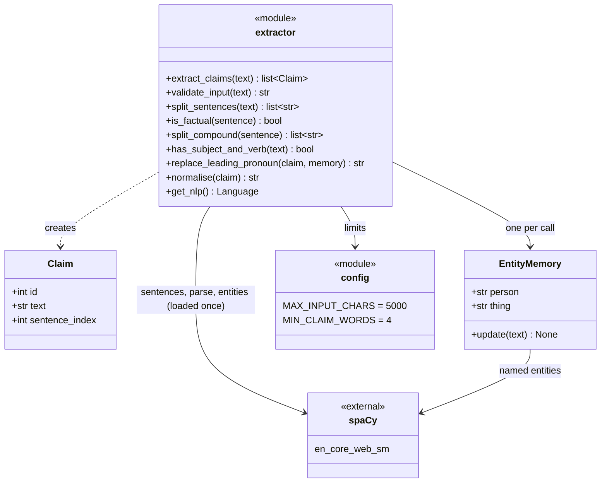
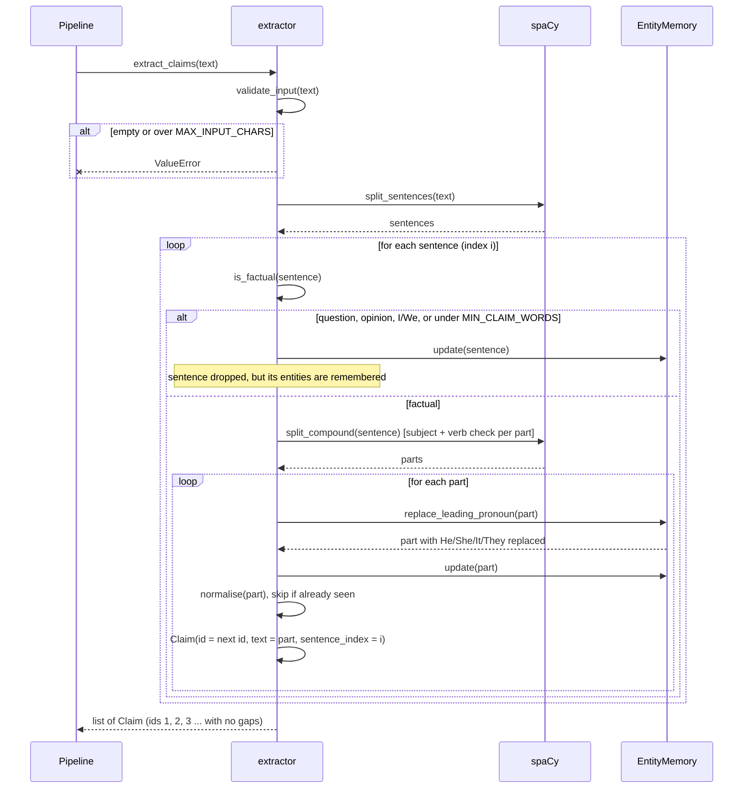

# Claim Extractor: Design (DH-188)

Module: `src/dehallucinator/claims/extractor.py`.
Requirements covered: FR-1.1 to FR-1.7.

## Class diagram

The extractor is mostly functions in one module, so the module is shown as a class
with the `<<module>>` stereotype. `EntityMemory` is a real class: it remembers the last
person and the last thing named, for pronoun replacement.

## Sequence diagram: extract_claims()

## Design decisions

| Decision | Reason |
|---|---|
| spaCy model loaded once with `lru_cache` | Loading takes about a second; the corrector reuses the same model, so sentence numbers match. |
| A compound sentence is split only when both parts have a subject and a verb | Keeps lists like "Salt and pepper are spices." as one claim (FR-1.4). |
| The subject of a sentence wins over other entities in `EntityMemory` | In "The Eiffel Tower is in Paris. It is 330 m tall.", "It" means the tower, not Paris (FR-1.5). |
| He/She look up people only; It/They look up things only | In "Apple was founded by Steve Jobs.", "It" is Apple and "He" is Steve Jobs. |
| De-duplication runs after pronoun replacement | "It is in Paris." is caught as a repeat of "The Eiffel Tower is in Paris." (FR-1.6). |
| `sentence_index` is the original sentence, even for split claims | The corrector uses it to find where to put the tag in the answer. |
