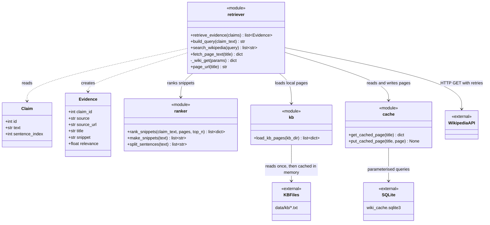
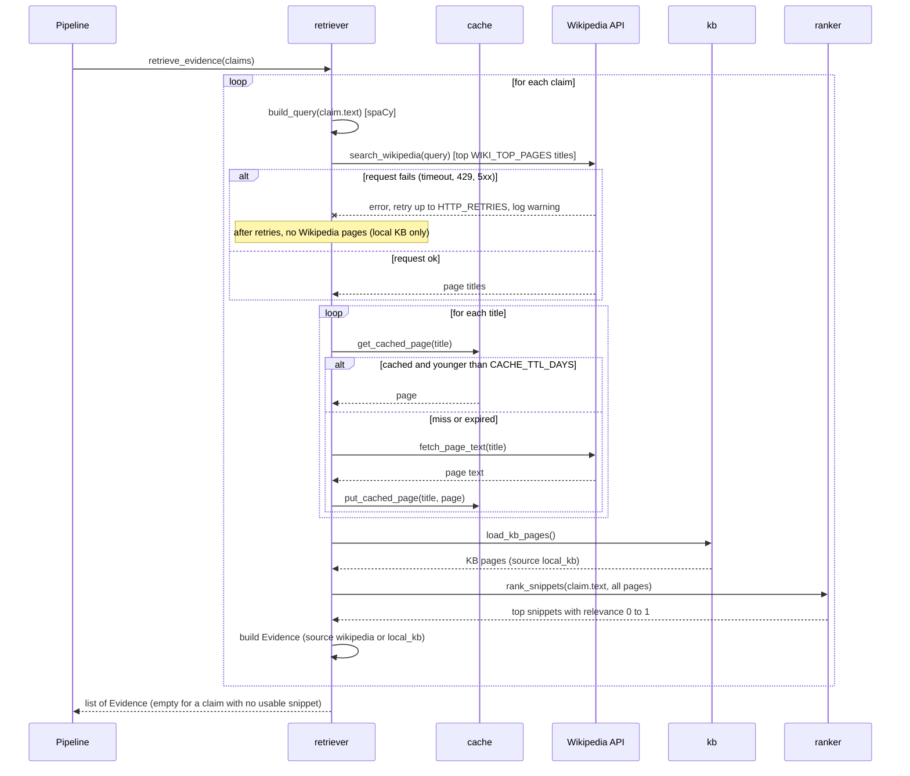

# Evidence Retriever: Design (DH-189)

Module: `src/dehallucinator/evidence/` (`retriever.py`, `ranker.py`, `kb.py`, `cache.py`).
Requirements covered: FR-2.1 to FR-2.8.

## Class diagram

The retriever is built from functions grouped in modules, so each module is shown
as a class with the `<<module>>` stereotype.

## Sequence diagram: retrieve_evidence()

