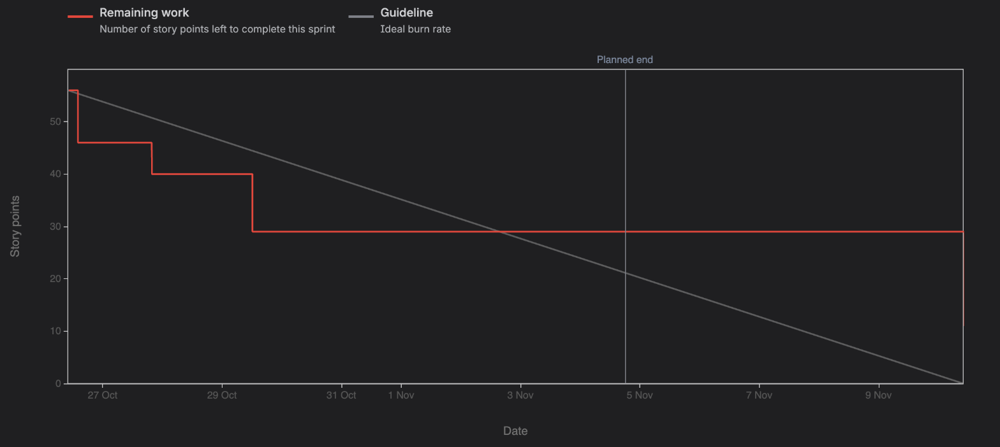

# Sprint 2 – Smart + connected (26 Oct – 4 Nov 2026)

Scrum Master: Sai Nikitha Perumalla (Role A)

**Goal:** Harder cases handled (compound split, pronouns, dedupe, number mismatch); local KB +
cache; demo UI and decorator; full Jenkins pipeline with Docker and security scans; design doc.

**Committed stories (19, 56 points):** DH-163, DH-164, DH-165, DH-169, DH-170, DH-174, DH-178,
DH-179, DH-180, DH-181, DH-182, DH-188, DH-189, DH-190, DH-191, DH-192, DH-196, DH-212, DH-213
**Completed:** 16 of 19 (45 of 56 points)
**Carried over to Sprint 3:** DH-180 (full Jenkins pipeline), DH-181 (Docker image) and DH-191
(Role D design doc). Their PRs #38 → #39 → #40 are open; #38 is waiting for a SonarCloud
security-rating fix. The sprint was closed in Jira on 10 Nov, once the last reviewed pull
requests had been merged.

### Features (Epics E3–E7)

| Ticket | Story | Owner | Points | Evidence | Status |
|---|---|---|---|---|---|
| DH-163 | Split compound sentences into separate claims | Nikitha (A) | 5 | PR #32 | Done |
| DH-164 | Replace leading pronouns with the named entity | Nikitha (A) | 5 | PR #32 | Done |
| DH-165 | Remove duplicate claims, number claims without gaps | Nikitha (A) | 2 | PR #32 | Done |
| DH-169 | Search the local knowledge base (works offline) | Shreya (B) | 3 | PRs #26, #27 | Done |
| DH-170 | SQLite cache and safe network handling with retries | Shreya (B) | 5 | PR #28 | Done |
| DH-174 | Catch wrong numbers and years (FR-3.5) | Ralph (C) | 3 | PR #30 | Done |
| DH-178 | `@dehallucinate` decorator | Satwik (D) | 2 | PR #34 | Done |
| DH-179 | Streamlit demo chatbot UI and 10 sample answers | Satwik (D) | 5 | PR #35 | Done |
| DH-180 | Full 8-stage Jenkins pipeline | Satwik (D) | 5 | PR #39 (open) | Carried over |
| DH-181 | Docker image | Satwik (D) | 3 | PR #38 (open) | Carried over |
| DH-182 | bandit and pip-audit in CI | Satwik (D) | 2 | PR #37 | Done |

### Documentation, testing and process (Epics E8–E11)

| Ticket | Task | Owner | Points | Evidence | Status |
|---|---|---|---|---|---|
| DH-188 | Design: Claim Extractor class and sequence diagrams | Nikitha (A) | 2 | PR #33 | Done |
| DH-189 | Design: Evidence Retriever class and sequence diagrams | Shreya (B) | 2 | PR #29 | Done |
| DH-190 | Design: Verifier class and sequence diagrams | Ralph (C) | 2 | PR #31 | Done |
| DH-191 | Design: Corrector, pipeline and API spec | Satwik (D) | 3 | PR #40 (open) | Carried over |
| DH-192 | Compile and export the Architecture and Design documents | Nikitha (A) | 2 | PR #41, submission PDFs | Done |
| DH-196 | Test cases TC-4-01..10 (UC-4) | Satwik (D) | 2 | PR #36 | Done |
| DH-212 | Sprint 0 log | Nikitha (A) | 1 | PR #23 | Done |
| DH-213 | Sprint 1 review and retrospective | Nikitha (A) | 2 | PR #42 | Done |

**Quality at the end of the sprint** (from `pytest --cov` and SonarQube Cloud, 10 Nov):
153 tests passing (unit and integration), 92% line and branch coverage, `ruff` clean, all 40
test cases TC-1-01 to TC-4-10 passing, SonarQube quality gate passing on every merged pull
request.

## Planning (26 Oct)

- Closed Sprint 1 (21 of 24 done) and moved DH-196, DH-212 and DH-213 into Sprint 2.
- Picked the "smart" stories from the backlog for each module, plus one design-doc ticket per
  person so the Software Design document could be compiled at the end of the sprint.
- First job agreed: wire up `retrieve_evidence()`, which still raised `NotImplementedError`,
  so the whole pipeline could run on real data.

## Progress log (from GitHub and Jira)

| Date | Who | What |
|---|---|---|
| 26 Oct | Nikitha | Sprint 2 started (19 tickets, 56 points); Sprint 0 log merged (PR #23) |
| 26 Oct | Shreya | `retrieve_evidence()` wired up (PR #26); DH-169 local KB (PR #27); DH-170 cache and retries (PR #28); DH-189 retriever design (PR #29) — all reviewed and merged the same day |
| 26 Oct | Nikitha | DH-163/164/165 compound split, pronoun replacement and dedupe (PR #32); DH-188 extractor design (PR #33) |
| 26–27 Oct | Ralph | DH-174 number-mismatch rule (PR #30) and DH-190 verifier diagrams (PR #31); review found that the number regex kept a sentence's full stop ("1879.") and wrongly contradicted true claims, and that the design file was cut off — both fixed and merged on 27 Oct |
| 27 Oct | Satwik | Opened stacked PRs #34–#40 for all seven of his tickets |
| 29 Oct | Satwik | DH-178 decorator (PR #34), DH-179 demo UI (PR #35), DH-196 UC-4 test cases (PR #36), DH-182 security stage (PR #37) merged; #38 and #39 held back for SonarCloud security findings |
| 7 Nov | Nikitha | Built the Team 14 submission documents; found that the DH-190 merge had cut `architecture.md` off mid-way and restored it (PR #41); Sprint 1 log (PR #42) |
| 9 Nov | Shreya | Reviewed and approved PRs #32, #33, #41, #42 and #43 |
| 10 Nov | Nikitha | Merged #32, #33, #41, #42 and #43; closed Sprint 2 and moved DH-180, DH-181 and DH-191 to Sprint 3 |

## Review

- **Nikitha:** an answer with a compound sentence, a pronoun and a repeated fact becoming
  clean claims ("Einstein was born in 1879, and he won the Nobel Prize in 1921." → two claims,
  "he" → "Einstein"); the extractor design diagrams; the compiled architecture and design PDF.
- **Shreya:** the full retriever on a real claim — Wikipedia plus the local knowledge base,
  then the same lookup again served from the SQLite cache; the offline fallback when the
  network is blocked.
- **Ralph:** a wrong year ("born in 1899") flagged CONTRADICTED by the number rule even when
  the NLI model is unsure; the verifier class and sequence diagrams.
- **Satwik:** the Streamlit demo checking the 10 sample answers with green, red and grey
  claims; the `@dehallucinate` decorator; bandit and pip-audit running in Jenkins.

## Retrospective

**Went well**
- The pipeline now runs end to end on real data: a real answer is split into claims, checked
  against Wikipedia and the local KB, and corrected with sources.
- Reviews caught real bugs before they reached users or the submission: the number regex
  that contradicted true claims, a truncated design file, a half-deleted `architecture.md`
  and a Mermaid syntax error that stopped a diagram rendering.
- Coverage stayed at 92% while the code grew, and every test still runs offline in seconds.
- Stacked pull requests let Satwik deliver seven tickets that could still be reviewed and
  merged one at a time.

**Didn't go well**
- Pull requests waited too long for review: #32 and #33 were open for 15 days, so the burndown
  stayed flat from 29 Oct and the sprint was closed 6 days after its planned end.
- The SonarCloud finding on #38 stayed unfixed for two weeks, so the Docker image and the
  full Jenkins pipeline slipped to Sprint 3.
- A merge-conflict resolution silently deleted half of `architecture.md`, and nobody noticed
  until the documents were compiled.
- Docker Desktop was not installed on the build laptop, so the image could not be built and
  tested during the sprint.

**We will change**
- Review every pull request within 24 hours; if you are asked, approve or comment the same day.
- Open pull requests by Thursday of each week so the weekend is left for review and fixes.
- After resolving a merge conflict, read the whole diff of the affected file before pushing.
- Fix SonarCloud findings on the day they appear, or ask the SonarQube owner (Ralph) to review
  them.
- Install and test tools (Docker, Jenkins agents) at the start of the sprint, not the end.

**Burndown** (Jira sprint burndown chart, story points): work burned from 56 to 29 points by
29 Oct, stayed flat while pull requests waited for review, and dropped to 0 when the sprint
was closed on 10 Nov (18 points merged, 11 points carried over to Sprint 3).

